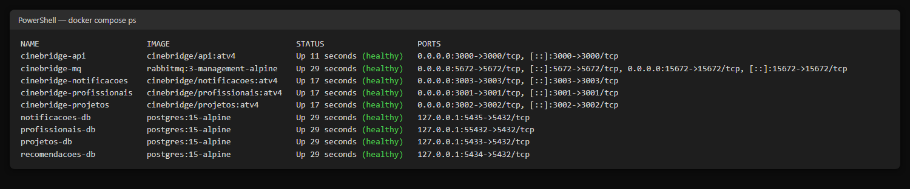
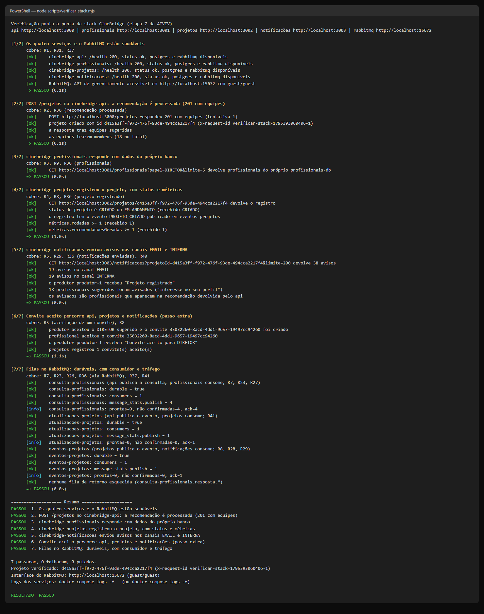
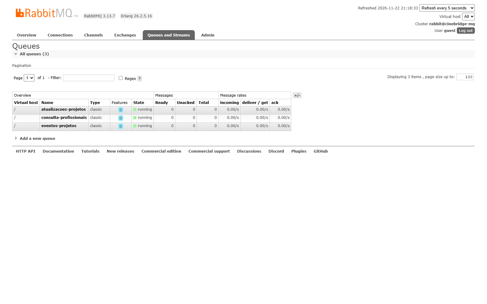
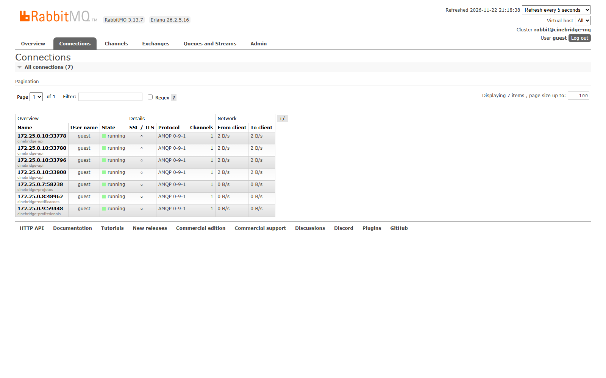
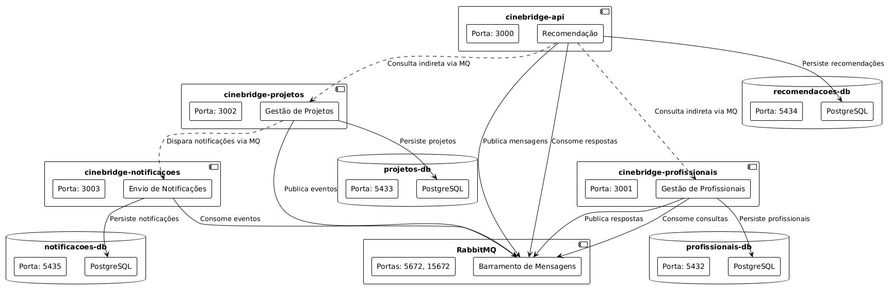

# CineBridge — Recomendação e Orquestração de Equipes em Microsserviços

API REST que recebe um projeto audiovisual, ranqueia os profissionais cadastrados
para cada papel técnico e monta sugestões de equipe dentro do orçamento e do prazo,
notificando os envolvidos e registrando tudo em auditoria. Cada tipo de projeto
(documentário, animação, publicidade e ficção) tem os próprios dados, regras de
validação, recomendador e avisos.

Desde a ATVIV a plataforma **CineBridge** roda em **quatro microsserviços** Node.js/TypeScript —
`cinebridge-api` (recomendação e orquestração), `cinebridge-profissionais`, `cinebridge-projetos` e
`cinebridge-notificacoes` —, cada um com o **próprio PostgreSQL**, conversando **só pelo RabbitMQ**
(`cinebridge-mq`). Os nove containers sobem juntos com um `docker compose up -d`, na rede
`cinebridge-net`, com health check em todos.

**Atividades ATVI a ATVIV** — Técnicas de Programação — Prof. Dr. Eng. Gerson Penha

| Atividade  | O que entrega                                                                                                                                                     |
| ---------- | ----------------------------------------------------------------------------------------------------------------------------------------------------------------- |
| **ATVI**   | O microsserviço com **Strategy**, **Template Method**, **Observer** e **Visitor**                                                                                 |
| **ATVII**  | Análise crítica do código da ATVI ([docs/analise-critica.md](docs/analise-critica.md)) e refatoração com **Prototype**, **Factory Method** e **Abstract Factory** |
| **ATVIII** | Análise de anti-padrões ([docs/analise-antipadroes.md](docs/analise-antipadroes.md)) e extensão com **Adapter**, **Composite** e **Decorator**                    |
| **ATVIV**  | Containerização em **4 microsserviços**, cada um com seu **PostgreSQL**, mensageria com **RabbitMQ** (`amqplib`), **health checks** e **Docker Compose**          |

---

## Tecnologias

|                                               | Versão                             |
| --------------------------------------------- | ---------------------------------- |
| Node.js (LTS)                                 | 22 (imagem `node:22-alpine`)       |
| TypeScript (modo estrito)                     | 6                                  |
| Fastify + TypeBox                             | 5 / 1                              |
| TypeORM (api)                                 | 1.1                                |
| `pg` (profissionais, projetos e notificações) | 8                                  |
| PostgreSQL                                    | 15 (`postgres:15-alpine`)          |
| RabbitMQ                                      | 3 (`rabbitmq:3-management-alpine`) |
| `amqplib`                                     | 2.4                                |
| Vitest                                        | 5                                  |
| Docker Compose                                | v2 (`docker compose`)              |

## O que precisa estar instalado na máquina

| Programa                                                         | Para quê                               | Download                                       |
| ---------------------------------------------------------------- | -------------------------------------- | ---------------------------------------------- |
| **Git**                                                          | clonar o repositório                   | https://git-scm.com/downloads                  |
| **Docker Desktop** (Windows 10/11, com WSL 2)                    | executar os 9 containers               | https://www.docker.com/products/docker-desktop |
| **Docker Engine + plugin Compose** (Ubuntu 24.04.3+ e derivadas) | executar os 9 containers               | https://docs.docker.com/engine/install/ubuntu/ |
| **Node.js 22.12+** (LTS, versão no `.nvmrc`)                     | testes, demonstração e desenvolvimento | https://nodejs.org                             |

No Ubuntu, instale o Docker Engine pelo repositório oficial da Docker (pacotes `docker-ce` e
`docker-compose-plugin`) e acrescente o usuário ao grupo `docker`
(`sudo usermod -aG docker $USER`; depois saia e entre de novo na sessão).

Para **só executar a plataforma** bastam Git e Docker: cada `Dockerfile` instala as
dependências, compila o TypeScript e gera a imagem final só com o código compilado
e as dependências de produção.

As portas `3000` a `3003` (serviços), `5432` a `5435` (bancos), `5672` e `15672` (RabbitMQ)
precisam estar livres. Se alguma estiver ocupada, veja
[Porta ocupada no host](#porta-ocupada-no-host).

| Para                                              | Precisa                                         |
| ------------------------------------------------- | ----------------------------------------------- |
| Executar a plataforma (`docker compose up -d`)    | Git e Docker                                    |
| Rodar a demonstração dos padrões (`npm run demo`) | **Node.js 22.12+**                              |
| Rodar os testes, a cobertura e o teste de carga   | **Node.js 22.12+** e Docker (para o PostgreSQL) |
| Desenvolver (`npm run dev` em cada serviço)       | **Node.js 22.12+** e Docker (bancos e RabbitMQ) |

Para conferir: `git --version`, `docker --version`, `docker compose version`,
`docker-compose --version` e `node -v`.

Com o Node instalado, rode `npm ci` uma vez na pasta de cada serviço (`servicos/<serviço>`) antes
de qualquer comando `npm run`.

---

## Como executar

```bash
git clone https://github.com/pedrodevroot/atv4.git
cd atv4
docker compose up -d --build
```

Nada para configurar: usuários, senhas e nomes dos bancos têm valor padrão no
`docker-compose.yml`, e cada serviço lê o seu `servicos/<serviço>/.env.docker` (versionado, só com
valores de desenvolvimento). O mesmo comando funciona no Windows 10+ (PowerShell), no Ubuntu
24.04.3+ e em distribuições derivadas do Ubuntu. Com o Compose antigo, o equivalente é
`docker-compose up -d --build`; o recomendado é o plugin v2 (`docker compose`), que foi o testado.

> A ATVIII usava os containers `cinebridge-recomendacao` (porta 3000) e `cinebridge-postgres`
> (porta 5434). Se ela estiver no ar nesta máquina, pare-a antes (`docker compose down` na pasta
> dela). O volume antigo (`cinebridge-pgdata`, do PostgreSQL 18) não é reaproveitado: a ATVIV cria
> volumes novos (`cinebridge-*-dados`) e não mexe nele.

|                                   | Endereço                                                                        |
| --------------------------------- | ------------------------------------------------------------------------------- |
| API (`cinebridge-api`)            | http://localhost:3000                                                           |
| Documentação interativa (Swagger) | http://localhost:3000/docs                                                      |
| `cinebridge-profissionais`        | http://localhost:3001                                                           |
| `cinebridge-projetos`             | http://localhost:3002                                                           |
| `cinebridge-notificacoes`         | http://localhost:3003                                                           |
| RabbitMQ (interface web)          | http://localhost:15672 — usuário/senha `guest`/`guest`                          |
| RabbitMQ (AMQP)                   | localhost:5672                                                                  |
| `profissionais-db`                | localhost:5432 — base `cinebridge_profissionais`, usuário/senha `profissionais` |
| `projetos-db`                     | localhost:5433 — base `cinebridge_projetos`, usuário/senha `projetos`           |
| `recomendacoes-db`                | localhost:5434 — base `cinebridge_recomendacao`, usuário/senha `recomendacao`   |
| `notificacoes-db`                 | localhost:5435 — base `cinebridge_notificacoes`, usuário/senha `notificacoes`   |

O comando sobe **9 containers**: os 4 microsserviços, os 4 PostgreSQL e o RabbitMQ. Os bancos
aceitam conexão do host só por `127.0.0.1`. Na primeira subida cada serviço aplica as próprias
migrações, e o `cinebridge-profissionais` cadastra **10.000 profissionais** de demonstração
(**9,4 s** medidos; desligável com `SEED_AO_INICIAR=false` no `.env.docker` do profissionais). A
API roda em cluster com 4 processos (`WEB_CONCURRENCY`).

Medido no Windows 11 (Docker Engine 29.5.3, Compose v5.1.4): cada imagem leva **19 a 25 s** para
ser construída (com a imagem base em cache) e fica com **278 a 340 MB**; com as imagens prontas e
os volumes já semeados, os **9 containers ficam `healthy` em 28 s**. Na primeira vez entram também
o download das imagens e o seed.

### Porta ocupada no host

Todas as portas do host aceitam variável: `API_PORTA`, `PROFISSIONAIS_PORTA`, `PROJETOS_PORTA`,
`NOTIFICACOES_PORTA`, `PROFISSIONAIS_DB_PORTA`, `PROJETOS_DB_PORTA`, `RECOMENDACOES_DB_PORTA`,
`NOTIFICACOES_DB_PORTA`, `RABBITMQ_PORTA` e `RABBITMQ_UI_PORTA`. Os valores padrão estão no
`.env.example` da raiz. Dentro da rede nada muda: todo banco continua na porta 5432.

O caso mais comum é um PostgreSQL instalado no Windows ocupando a 5432. O erro é
`ports are not available: exposing port TCP 127.0.0.1:5432`, e a solução é trocar só a porta do
host do `profissionais-db`:

```bash
cp .env.example .env               # PowerShell: Copy-Item .env.example .env
# no .env, troque para PROFISSIONAIS_DB_PORTA=55432
docker compose up -d --build
```

Ou só na sessão atual: `export PROFISSIONAIS_DB_PORTA=55432` (PowerShell:
`$env:PROFISSIONAIS_DB_PORTA='55432'`).

### Máquina com pouca memória

Medido com `docker stats`: com os 4 processos do api a stack usa cerca de **1,3 GB estável e
2,0 GB no pico** (o api chega a 855 MiB enquanto os 4 processos carregam o cadastro); com 2
processos, cerca de **0,9 GB estável e 1,3 GB no pico**. Em máquina com 8 GB de RAM ou menos:

- construa uma imagem por vez (`docker compose build cinebridge-profissionais`, depois
  `cinebridge-projetos`, `cinebridge-notificacoes` e `cinebridge-api`) e só então
  `docker compose up -d`;
- rode o api com 2 processos, com um arquivo `compose.leve.yml` ao lado do `docker-compose.yml`:

```yaml
services:
  cinebridge-api:
    environment:
      WEB_CONCURRENCY: 2
```

```bash
docker compose -f docker-compose.yml -f compose.leve.yml up -d
```

No Windows, a VM do WSL guarda o cache de páginas dos builds e devolve pouca memória ao sistema.
`wsl -d docker-desktop -u root sh -c "sync; echo 1 > /proc/sys/vm/drop_caches"` libera esse cache
sem mexer nos containers.

### Conferir se subiu

```bash
docker compose ps                         # os 9 com (healthy)
curl http://localhost:3000/health         # no PowerShell use curl.exe
curl http://localhost:3001/health
curl http://localhost:3002/health
curl http://localhost:3003/health
docker compose logs -f                    # ou docker-compose logs -f
```



```json
{
  "status": "ok",
  "timestamp": "2026-11-22T12:00:00.000Z",
  "dependencias": { "postgres": "disponivel", "rabbitmq": "disponivel" }
}
```

Os quatro `/health` respondem **200** com o PostgreSQL e o RabbitMQ disponíveis e **503** quando
qualquer um dos dois está fora:

```json
{
  "status": "degradado",
  "timestamp": "2026-11-22T12:00:00.000Z",
  "dependencias": { "postgres": "disponivel", "rabbitmq": "indisponivel" }
}
```

Nos logs, cada serviço mostra as conexões com o banco e com o RabbitMQ:

| Serviço                    | O que procurar em `docker compose logs -f`                                                                                                                    |
| -------------------------- | ------------------------------------------------------------------------------------------------------------------------------------------------------------- |
| `cinebridge-profissionais` | `Seed profissionais: 10000 registros`, `Conectado ao RabbitMQ em cinebridge-mq:5672`, `Consumindo a fila consulta-profissionais`                              |
| `cinebridge-projetos`      | `Conectado ao RabbitMQ em cinebridge-mq:5672`, `Consumindo a fila atualizacoes-projetos`                                                                      |
| `cinebridge-notificacoes`  | `Conectado ao RabbitMQ em cinebridge-mq:5672`, `Consumindo a fila eventos-projetos`                                                                           |
| `cinebridge-api`           | `Migrações aplicadas`, `Cluster iniciado`, `Consulta publicada na fila consulta-profissionais`, `Cache do cadastro aquecido pela fila consulta-profissionais` |

Os três serviços novos também registram `Conectado ao PostgreSQL; migrações em dia`, e todos
terminam com `<serviço> ouvindo na porta <N>`.

### Testar pela API

- **Swagger** (http://localhost:3000/docs): abra a rota, clique em **Try it out**, preencha os
  campos e o corpo e clique em **Execute**. Os ids (`projetoId`, `equipeId`, `conviteId`) vêm nas
  respostas e são usados nas rotas seguintes.
- **[requests.http](requests.http)** (extensão REST Client do VS Code): o fluxo inteiro, na ordem,
  incluindo os exemplos da ATVII, da ATVIII e da ATVIV (os quatro `/health`, os serviços novos e a
  API de gerenciamento do RabbitMQ).

Os corpos prontos para copiar estão em [Endpoints](#endpoints). As datas dos projetos precisam
estar no futuro: a entrega não pode ter passado.

### Verificar o fluxo completo (etapa 7)

Com a stack no ar:

```bash
node scripts/verificar-stack.mjs
```

O script não precisa de `npm ci` e termina com código 0 se os 7 passos passarem: os quatro
`/health`, o `POST /projetos` no api, o cadastro no profissionais, o registro no projetos, os
avisos no notificações, um convite aceito percorrendo os quatro serviços e as filas na API de
gerenciamento do RabbitMQ. Na verificação final ele passou **7 de 7** com 2 e com 4 processos no
api, depois dos testes de falha e depois de um `down`/`up`.



O mesmo roteiro, à mão:

1. `POST http://localhost:3000/projetos` com o corpo **A**: responde 201 com as equipes sugeridas.
2. `GET http://localhost:3002/projetos/{projetoId}`: o projeto está no `cinebridge-projetos`, com
   status `CRIADO` e as métricas da rodada.
3. `GET http://localhost:3003/notificacoes?projetoId={projetoId}`: avisos nos canais `EMAIL` e
   `INTERNA` ("Projeto registrado" para o produtor e "Um produtor tem interesse no seu perfil" para
   cada profissional sugerido). Na verificação foram **38 avisos** (19 + 19) para 18 membros.
4. Aceite do diretor e resposta do convite (corpo **D** com `"aceito": true`): o produtor recebe
   "Convite aceito para DIRETOR" e `metricas.convites.aceitos` sobe no projetos.
5. Interface do RabbitMQ em http://localhost:15672 (`guest`/`guest`), aba **Queues and Streams**:
   as filas `consulta-profissionais`, `atualizacoes-projetos` e `eventos-projetos`, com a marca
   **D** (durável), 1 consumidor cada e as taxas de publicação e entrega.



Na aba **Connections** aparecem as conexões AMQP de cada serviço: uma por processo do api (4) e uma
de cada serviço novo.



A consulta de profissionais **não acontece a cada POST**. O api guarda o cadastro em cache por 60 s
e o recarrega em segundo plano: a consulta `listar-ativos` vai para a fila `consulta-profissionais`
na subida (uma por processo do api) e depois que o cache vence, quando a primeira requisição
seguinte responde com o cadastro em memória e dispara a recarga sem esperar por ela. Para ver a
troca de mensagens:

```bash
docker compose logs -f cinebridge-profissionais   # "Consulta de profissionais respondida (listar-ativos)"
docker compose logs -f cinebridge-api             # "Consulta publicada na fila consulta-profissionais"
```

ou, na interface do RabbitMQ, os gráficos da fila `consulta-profissionais`. Durante a consulta
aparece a fila de retorno `consulta-profissionais.resposta.<uuid>`, que some logo depois. Ela é
exclusiva da conexão do api, e por isso a interface a mostra como **não durável**.

Teste de falha (as mensagens esperam na fila durável):

```bash
docker compose stop cinebridge-projetos cinebridge-notificacoes
# POST /projetos: o api responde 201; atualizacoes-projetos fica com mensagens prontas e 0 consumidores
docker compose start cinebridge-projetos cinebridge-notificacoes
# as mensagens são consumidas, e o projeto e os avisos aparecem
```

### Parar

```bash
docker compose down        # para os containers e mantém os dados
docker compose down -v     # para e apaga os 4 bancos e as filas do RabbitMQ
```

### Executar fora do Docker (desenvolvimento)

```bash
docker compose up -d --wait cinebridge-mq profissionais-db projetos-db recomendacoes-db notificacoes-db

cd servicos/cinebridge-profissionais
npm ci
cp .env.example .env       # PowerShell: Copy-Item .env.example .env
npm run dev                # http://localhost:3001; migrações e seed se o banco estiver vazio
```

Repita os três últimos comandos em `servicos/cinebridge-projetos` (porta 3002) e
`servicos/cinebridge-notificacoes` (porta 3003). No api:

```bash
cd servicos/cinebridge-api
npm ci
cp .env.example .env       # PowerShell: Copy-Item .env.example .env
npm run db:preparar        # só as migrações; o seed agora é do cinebridge-profissionais
npm run dev                # http://localhost:3000, recarrega ao salvar
```

Os `.env.example` apontam para `localhost` e para a porta do host de cada banco (5432 a 5435).

---

## Os dez padrões de projeto

Precisa do **Node.js 22.12+**; não precisa de Docker nem de banco.

```bash
cd servicos/cinebridge-api
npm ci
npm run demo
```

Imprime as dez demonstrações: as quatro da ATVI, as três da ATVII e as três da ATVIII. Os
padrões continuam no `cinebridge-api`, e os caminhos da tabela são relativos a
`servicos/cinebridge-api/`. A ATVIV não acrescenta padrão novo: reaproveita o **Observer** nos
consumidores do RabbitMQ.

| Padrão               | Onde está                                                      | O que a demonstração prova                                                                                                                                                                                                                                     | Teste                                                      |
| -------------------- | -------------------------------------------------------------- | -------------------------------------------------------------------------------------------------------------------------------------------------------------------------------------------------------------------------------------------------------------- | ---------------------------------------------------------- |
| **Strategy**         | `src/application/strategies`                                   | Mesmo projeto e mesmo cadastro: cosseno escolhe Helena Técnica, colaborativa escolhe Marta Consagrada, regras de orçamento escolhem Caio Local                                                                                                                 | `demonstracao-strategy.test.ts`                            |
| **Template Method**  | `src/application/orchestration`                                | `OrquestradorPadrao` e `OrquestradorSubstituicao` executam as mesmas 7 etapas; falha na validação interrompe antes de buscar; sobrescrever `orquestrar()` é recusado                                                                                           | `demonstracao-template-method.test.ts`                     |
| **Observer**         | `src/application/observers` + `infrastructure/messaging`       | Um observador falha e e-mail, mensagem interna, auditoria e integração continuam; entrega assíncrona; observador lento não atrasa os demais. Na ATVIV, cada fila do RabbitMQ tem um `ConsumidorFila` (Sujeito) com observadores registrados nos serviços novos | `demonstracao-observer.test.ts`, `consumidor-fila.test.ts` |
| **Visitor**          | `src/application/visitors`                                     | Validação, compatibilidade e relatório sobre a mesma árvore; a árvore não muda; um visitante novo não exige alterar o domínio                                                                                                                                  | `demonstracao-visitor.test.ts`                             |
| **Prototype**        | `src/domain/entidades/projetos` + `application/prototipos`     | `clonar()` em cada subclasse de `Projeto` faz cópia profunda; modelos pré-configurados são clonados e ajustados; mexer no clone não altera o protótipo                                                                                                         | `demonstracao-prototype.test.ts`                           |
| **Factory Method**   | `src/application/familias/*/fabrica-*.ts`                      | `criarProjeto`, `criarValidador`, `criarRecomendador` e `criarNotificador` são abstratos em `FabricaProjeto`; cada subclasse decide a classe concreta                                                                                                          | `demonstracao-abstract-factory.test.ts`                    |
| **Abstract Factory** | `src/application/familias` + `sistema-recomendacao.ts`         | Mesmo cadastro e mesmos papéis: trocar a fábrica troca recomendação, validação e notificação; um tipo novo entra só com uma fábrica nova                                                                                                                       | `fabricas-projeto.test.ts` (integração)                    |
| **Adapter**          | `application/ports/adaptador-*` + `infrastructure/adaptadores` | O mesmo caso de uso funciona com 3 armazenamentos, 3 gateways e 3 cadastros; cada adaptador traduz formatos, unidades e status do seu sistema                                                                                                                  | `adapter.test.ts` (integração)                             |
| **Composite**        | `src/domain/entidades/servicos`                                | Serviço atômico e pacote respondem pela mesma interface; custo, prazo e validação descem a árvore; `Projeto` delega ao serviço principal                                                                                                                       | `composite.test.ts` (integração)                           |
| **Decorator**        | `src/application/strategies/decoradores`                       | Cache, auditoria e compressão em qualquer ordem, sem alterar o recomendador nem o `SistemaRecomendacao`; o ranking final é o mesmo do recomendador base                                                                                                        | `decorator.test.ts` (integração)                           |

A classe `SistemaRecomendacao` (`src/application/sistema-recomendacao.ts`) reproduz a API dos
diagramas das atividades — `definirEstrategia`, `executarRecomendacao`, `adicionarObservador`,
`notificarObservadores` e `configurarAdaptadores` —, unindo Strategy, Observer e Adapter; desde a
ATVII ela também identifica o tipo do projeto e escolhe a fábrica (teste
`sistema-recomendacao.test.ts`). A interface `RecomendacaoStrategy` dos diagramas é um apelido de
`EstrategiaRecomendacao`, e `executarRecomendacao` devolve um `ResultadoOrquestracao`, que contém as
equipes sugeridas.

---

## Tipos de projeto (ATVII)

Cada tipo de projeto é uma **família** de objetos criada pela sua fábrica:

| Tipo           | Projeto (Prototype)                              | Validador (Visitor)                                                              | Recomendador (Strategy)                                           | Avisos ao produtor (Observer)                 |
| -------------- | ------------------------------------------------ | -------------------------------------------------------------------------------- | ----------------------------------------------------------------- | --------------------------------------------- |
| `DOCUMENTARIO` | `ProjetoDocumentario`: tema, entrevistados       | erro sem entrevistado; alerta sem sonoplasta; alerta se a direção não entrevista | perfil com entrevista e pesquisa na direção, som direto reforçado | agenda de entrevistas, autorizações de imagem |
| `ANIMACAO`     | `ProjetoAnimacao`: técnica, softwares, quadros/s | erro sem `EFEITOS_VISUAIS`; alerta sem softwares; alerta se VFX não modela/anima | perfil com animação, modelagem 3D e os softwares do projeto       | softwares 3D, capacidade de renderização      |
| `PUBLICITARIO` | `ProjetoPublicitario`: marca, veiculação, peças  | erro sem meio de veiculação; alerta com prazo acima de 90 dias                   | perfil com decupagem, color grading, ritmo e trilha               | aprovação do cliente, briefing da marca       |
| `FICCAO`       | `ProjetoFiccao`: o projeto da ATVI               | alerta se a direção não dirige atores                                            | perfil com direção de atores e dramaturgia                        | leitura de roteiro, plano de filmagem         |

O relatório da animação também traz **métricas de renderização**: quadros a produzir, ritmo
diário, horas de render estimadas e custo de efeitos visuais por quadro.

Como as peças se ligam:

1. `CriarProjetoERecomendar` pede ao `RegistroFabricas` a fábrica do `tipoCaptacao` e cria o
   projeto com `fabrica.criarProjeto(dados)`.
2. `SistemaRecomendacao.criarEcossistema(projeto)` identifica o tipo, seleciona a fábrica e monta
   com ela o orquestrador, o validador, o recomendador e o notificador.
3. `OrquestradorEquipe` recebe a fábrica no construtor. Na etapa de validação aplica
   `fabrica.criarValidador()`; se o produtor não escolheu estratégia, ranqueia com
   `fabrica.criarRecomendador()`. O fluxo de 7 etapas da ATVI não mudou, e o código do
   orquestrador não cita nenhum tipo concreto (um teste confere isso).
4. Os eventos do projeto vão para os observadores da ATVI **e** para o notificador da fábrica; o
   relatório é feito pelo gerador da fábrica (`criarGeradorRelatorio`). Na ATVIV os avisos do
   notificador de cada tipo continuam no api (caixa local, `GET /mensagens/{id}`); os avisos
   genéricos da ATVI passaram para o `cinebridge-notificacoes`.
5. `CatalogoModelos` guarda protótipos prontos (`documentario-entrevistas`, `animacao-3d-curta`,
   `publicitario-digital`, `ficcao-longa`); um projeto novo pode nascer como clone de um modelo,
   com os ajustes do produtor.

Decisões de projeto (os motivos estão na [análise crítica](docs/analise-critica.md)):

- `FICCAO` foi mantido, com fábrica própria, para não quebrar o que a ATVI entregou;
- o clone ganha id novo e não herda as equipes do original;
- a estratégia escolhida pelo produtor prevalece sobre o recomendador do tipo;
- a fábrica fica fora da entidade `Projeto`, para preservar a inversão de dependência;
- as regras do tipo valem para rodadas completas e não bloqueiam a substituição de um único papel.

Para acrescentar um tipo (por exemplo, realidade virtual): crie a subclasse de `Projeto`, o
validador, o recomendador, o notificador e a fábrica, e registre a fábrica em
`criarRegistroFabricas` (`servicos/cinebridge-api/src/container.ts`). Orquestrador, `SistemaRecomendacao`, casos de uso e
repositórios não mudam; o teste `fabricas-projeto.test.ts` faz isso com uma fábrica criada só no
teste.

---

## Integrações, serviços e decoradores (ATVIII)

### Adapter: provedores externos

Os sistemas externos são **simulados**: nenhuma chamada sai para a Amazon, o Google, a Stripe, o
PagSeguro, o PayPal, o LinkedIn ou o Indeed. O provedor é escolhido por variável de ambiente, e
`SistemaRecomendacao.configurarAdaptadores(armazenamento, pagamento, profissional)` permite trocar
em tempo de execução.

| Família       | Variável                 | Valores                         | Padrão    | O que o adaptador traduz                                                                       |
| ------------- | ------------------------ | ------------------------------- | --------- | ---------------------------------------------------------------------------------------------- |
| Armazenamento | `ARMAZENAMENTO_PROVEDOR` | `s3`, `google-cloud`, `local`   | `s3`      | `Buffer` e metadados para `File` e chave; id com o esquema `s3://`, `gs://` ou `local://`      |
| Pagamento     | `PAGAMENTO_PROVEDOR`     | `stripe`, `pagseguro`, `paypal` | `stripe`  | Centavos (Stripe) ou reais; códigos de status de cada gateway para `APROVADO` e `CANCELADO`    |
| Profissionais | `PROFISSIONAIS_PROVEDOR` | `interno`, `linkedin`, `indeed` | `interno` | Formato do perfil, cargos, endossos, salário em centavos e escala de notas para `Profissional` |

Decisões de projeto:

- Tipos próprios, como `MetadadosArquivo`, substituem o `any` do diagrama, que a regra de lint do
  projeto proíbe. Os adaptadores devolvem `Promise`, como as outras portas.
- A API roda em vários processos, então os simuladores de arquivos e pagamentos guardam o estado no
  PostgreSQL (`objeto_externo` e `transacao_externa`). O `local` usa o diretório
  `ARMAZENAMENTO_LOCAL_DIR`.
- O `AdaptadorProfissional` fica por baixo do repositório resiliente, então cache e disjuntor
  continuam valendo. Desde a ATVIV o cadastro interno vem do `cinebridge-profissionais` pela fila
  `consulta-profissionais`, e o banco do api não tem mais a tabela `profissional`: o perfil de cada
  membro, interno ou externo (ids `linkedin:*` e `indeed:*`), fica congelado em
  `membro_equipe.profissional` no momento da gravação.
- Um papel só é pago uma vez por equipe, garantido por índice único. Se duas chamadas simultâneas
  cobrarem, a segunda é estornada e responde 409.
- Um pagamento só é consultado ou cancelado no provedor em que foi feito.

### Composite: hierarquia de serviços

`ServicoProjeto` é a interface comum, com `calcularCusto`, `listarSubservicos`, `obterPrazo` e
`validar`. `ServicoAtomico` é a folha e `PacoteServico` contém outros serviços, atômicos ou pacotes.
`Projeto.servicoPrincipal` é a fonte dos dados, e `calcularCustoTotal` delega a ele.

Decisões de projeto:

- `POST /projetos` aceita `requisitos`, como antes, ou `servicoPrincipal`, nunca os dois. `requisitos`
  vira um pacote simples com custo e prazo zerados, porque um papel com peso não tem preço. Assim a
  ATVI e a ATVII continuam funcionando; os projetos já gravados são convertidos pela migração.
- `requisitos` e `papeisObrigatorios` agora são derivados da árvore, então estratégias e visitantes
  não mudaram. Dois serviços podem ter o mesmo papel: a lista derivada traz o papel uma vez, com o
  maior peso.
- O prazo de um pacote é a **soma** dos prazos dos filhos, ou seja, considera execução em sequência.
- `ServicoAtomico` tem `peso` (padrão 1) além do pedido no enunciado, porque o ranking depende dele.
- O custo acima do orçamento ou o prazo acima do período viram erro antes da recomendação (422) e
  aparecem no relatório como `ESTRUTURA_SERVICOS`. A árvore aceita até 6 níveis de pacotes, com até
  50 serviços em cada um.

### Decorator: comportamentos transversais

`RecomendadorBase` guarda o fluxo comum das estratégias da ATVI, e `DecoradorRecomendacao` é a base
de `CacheDecorator`, `AuditoriaDecorator` e `CompressaoDecorator`. Todos implementam
`RecomendacaoStrategy`, sem alterá-la. `MontadorDecoradores` monta a pilha:

| Origem da pilha                         | Como definir                                                             | Observação                                                                    |
| --------------------------------------- | ------------------------------------------------------------------------ | ----------------------------------------------------------------------------- |
| Política de configuração                | `DECORADORES=cache,auditoria,compressao`                                 | Padrão: vazio no código; `cache,auditoria,compressao` no `.env.docker` do api |
| Preferência do produtor, por requisição | Campo `decoradores` em `POST /projetos`, rodadas, modelos e substituição | Prevalece sobre a política; `[]` desliga                                      |

O primeiro item é aplicado primeiro e fica mais perto do recomendador. A ordem muda o comportamento:
em `cache,auditoria` a auditoria registra também os acertos do cache; em `auditoria,cache` registra
só as execuções reais.

- **Cache:** em memória, por processo. A chave considera as características do projeto (não o id),
  os parâmetros e os candidatos, então projetos iguais aproveitam o resultado e uma substituição, que
  exclui candidatos, não reaproveita um ranking antigo. Validade em `CACHE_RECOMENDACOES_TTL_MS` e
  limite em `CACHE_RECOMENDACOES_MAXIMO`.
- **Auditoria:** cada chamada vira uma entrada `RECOMENDADOR_EXECUTADO` em `GET /auditoria`, com
  estratégia, tempo de resposta, candidatos e resultado. Uma falha ao gravar não derruba a recomendação.
- **Compressão:** o ranking é guardado em gzip e descomprimido sob demanda. `RankingComprimido`
  informa `tamanhoOriginal`, `tamanhoComprimido` e a `carga` pronta para transmissão. A resposta HTTP
  da API continua em JSON sem compressão, porque o decorador atua na interface do recomendador.

---

## Containers e mensageria (ATVIV)



O monolito das atividades anteriores foi dividido em quatro microsserviços. Cada um tem a própria
pasta em `servicos/`, com `package.json`, `package-lock.json`, `Dockerfile`, `.env.docker` e
testes, e **só conhece o próprio banco**. Nenhum serviço chama outro por HTTP: toda conversa passa
pelo `cinebridge-mq`.

### Containers

| Container                  | Imagem                          | Porta (host) | Banco              | Papel                                                                                            |
| -------------------------- | ------------------------------- | ------------ | ------------------ | ------------------------------------------------------------------------------------------------ |
| `cinebridge-api`           | `cinebridge/api:atv4`           | 3000         | `recomendacoes-db` | recomendação e orquestração das ATVI–ATVIII; ponto de entrada REST                               |
| `cinebridge-profissionais` | `cinebridge/profissionais:atv4` | 3001         | `profissionais-db` | cadastro de profissionais, competências, avaliações, participações e disponibilidades; seed      |
| `cinebridge-projetos`      | `cinebridge/projetos:atv4`      | 3002         | `projetos-db`      | ciclo de vida, métricas e resultados de cada projeto; publica `eventos-projetos`                 |
| `cinebridge-notificacoes`  | `cinebridge/notificacoes:atv4`  | 3003         | `notificacoes-db`  | e-mails (simulados) e mensagens internas para produtores e profissionais; grava cada aviso       |
| `cinebridge-mq`            | `rabbitmq:3-management-alpine`  | 5672, 15672  | —                  | barramento de mensagens e interface de gerenciamento                                             |
| `profissionais-db`         | `postgres:15-alpine`            | 5432         | —                  | `profissional`, `competencia`, `avaliacao`, `participacao_projeto`, `disponibilidade`            |
| `projetos-db`              | `postgres:15-alpine`            | 5433         | —                  | `projeto`, `evento_projeto`                                                                      |
| `recomendacoes-db`         | `postgres:15-alpine`            | 5434         | —                  | as tabelas do api (projetos, equipes, convites, recomendações, auditoria...), sem `profissional` |
| `notificacoes-db`          | `postgres:15-alpine`            | 5435         | —                  | `notificacao`                                                                                    |

Todos ficam na rede `cinebridge-net` (`bridge`) e se encontram pelo nome do serviço. Dentro da rede
todo banco escuta na 5432; as portas 5432 a 5435 do diagrama são as do host. Cada banco tem um
volume nomeado, e o RabbitMQ também (`hostname: cinebridge-mq` fixo), para as mensagens
persistentes sobreviverem a um `down`/`up`.

### Filas

Todas usam a exchange padrão, com a routing key igual ao nome da fila, e são declaradas com as
mesmas opções por quem publica e por quem consome.

| Fila                                     | Quem publica                                                            | Quem consome (prefetch)        | Durável                                          | Confirmação                                |
| ---------------------------------------- | ----------------------------------------------------------------------- | ------------------------------ | ------------------------------------------------ | ------------------------------------------ |
| `consulta-profissionais`                 | api (`listar-ativos`)                                                   | profissionais (4)              | sim                                              | publisher confirms; `ack` manual           |
| `consulta-profissionais.resposta.<uuid>` | profissionais, no `replyTo`                                             | api, na mesma conexão          | exclusiva; a interface a mostra como não durável | `correlationId` igual ao da consulta       |
| `atualizacoes-projetos`                  | api (`EncaminhadorEventosProjeto`)                                      | projetos (1, preserva a ordem) | sim                                              | publisher confirms; `ack` depois de gravar |
| `eventos-projetos`                       | projetos (`PROJETO_CRIADO`, `PROJETO_ATUALIZADO`, `PROJETO_FINALIZADO`) | notificações (10)              | sim                                              | publisher confirms; `ack` depois de gravar |

As mensagens são persistentes. A fila de retorno é criada pelo api a cada consulta e apagada logo
depois da resposta ou do prazo (`CADASTRO_TIMEOUT_MS`, 15 s). A fila `atualizacoes-projetos` não
está no enunciado: ela materializa a seta "Consulta indireta via MQ" do api para o projetos no
diagrama.

### Fluxo de um `POST /projetos`

1. O api valida o projeto e o cria pela fábrica do tipo. O orquestrador pede candidatos ao cache do
   cadastro, alimentado pela fila `consulta-profissionais` (ver
   [Verificar o fluxo completo](#verificar-o-fluxo-completo-etapa-7)).
2. Na consulta, o `RespondedorConsultaProfissionais` do profissionais lê o `profissionais-db` e
   publica a resposta no `replyTo`, com o mesmo `correlationId`. Com 10 mil profissionais a resposta
   do `listar-ativos` tem **28,3 MiB** (9.491 perfis ativos) e chega em **1,5 a 3,8 s**, conforme o
   número de processos do api pedindo ao mesmo tempo.
3. O api ranqueia, monta as equipes, grava tudo no `recomendacoes-db` e responde **201**.
4. O evento `RECOMENDACAO_GERADA` vai para o barramento em memória da ATVI. O observador
   `EncaminhadorEventosProjeto` publica o evento, com um retrato do projeto, em
   `atualizacoes-projetos`.
5. O `RegistradorCicloVida` do projetos grava o registro e as métricas no `projetos-db` e publica
   `PROJETO_CRIADO` em `eventos-projetos`.
6. Os observadores `NotificadorEmail` e `NotificadorInterno` do notificações gravam os avisos no
   `notificacoes-db` e registram `E-mail enviado para <destinatário>: <assunto>`.

Um convite aceito segue o mesmo caminho a partir do passo 4, com `CONVITE_ACEITO`; o projetos
publica `PROJETO_ATUALIZADO` e o produtor recebe "Convite aceito para <papel>".

### Health checks

| Onde             | Comando no `docker-compose.yml`                         |
| ---------------- | ------------------------------------------------------- |
| 4 microsserviços | `curl -f http://localhost:<porta>/health`               |
| 4 bancos         | `pg_isready -h 127.0.0.1 -p 5432 -U postgres -d <base>` |
| `cinebridge-mq`  | `rabbitmq-diagnostics -q check_port_connectivity`       |

O `/health` de cada serviço confere o próprio PostgreSQL (`SELECT 1`) e o RabbitMQ (conexão e canal
abertos) e responde 200 ou 503, como em [Conferir se subiu](#conferir-se-subiu). O do api não depende
dos outros serviços, para que uma falha não derrube todos em cascata. Na verificação, parar o
`cinebridge-mq` levou os quatro a 503 em 3 s; ao subi-lo, os quatro voltaram a 200 em **11 s**, com
reconexão automática e os consumidores reassinados. Parar um banco levou só o seu serviço a 503. O
`depends_on` com `condition: service_healthy` faz cada serviço esperar o seu banco e o RabbitMQ, e o
api esperar também o profissionais.

### Entrega pelo menos uma vez e idempotência

Filas duráveis, mensagens persistentes, publisher confirms e `ack` manual garantem que nenhuma
mensagem confirmada se perde, mas permitem reentregas. Por isso os consumidores são idempotentes:

- o projetos guarda o id de cada atualização em `evento_projeto` e ignora a repetida, sem somar as
  métricas de novo (log `Atualização repetida; o evento de saída já foi publicado`);
- o notificações grava cada aviso com um índice único por evento, destinatário, canal e assunto, e
  só "envia" o e-mail se a linha for nova (log `E-mail já enviado antes ...; envio repetido ignorado`).

Demonstrado na verificação: com o projetos e o notificações parados, as mensagens ficaram na fila
(`ready=2`, 0 consumidores); uma delas foi publicada de novo, com o mesmo `messageId`, pela API de
gerenciamento. Ao religar os serviços, as 3 mensagens foram consumidas, o projeto ficou com
`recomendacoesGeradas: 1` e um único evento, e saíram exatamente **19** e-mails para o projeto, não 38.

### Limitação conhecida

Se o RabbitMQ ficar fora do ar **por mais de ~16 s**, um evento do api para o projetos se perde. O
`EncaminhadorEventosProjeto` faz 3 tentativas e desiste, com o log de erro
`Evento do projeto não foi encaminhado ao cinebridge-projetos`. O `POST /projetos` responde 201 (o
api recomenda com o cadastro que já tem em memória), mas aquele projeto não chega ao projetos nem às
notificações. A correção seria um outbox no api: gravar a mensagem no `recomendacoes-db`, na mesma
transação do projeto, e reenviá-la depois. Do projetos para o notificações esse outbox já existe:
o evento de saída fica em `evento_projeto` até ser confirmado.

### Dockerfiles

Os quatro seguem o roteiro do enunciado: `WORKDIR /usr/src/app`,
`COPY package.json package-lock.json ./`, `RUN npm install`, `COPY . .`, `EXPOSE <porta>` e
`CMD ["node", "dist/main.js"]`. São multi-stage: o estágio `build` compila o TypeScript com as
dependências de desenvolvimento, e a imagem final leva só `dist/` e as dependências de produção,
roda como o usuário `node` e instala o `curl` usado pelo health check. As migrações rodam dentro do
`main.js`, sem passo manual.

> **Desvio do enunciado:** a imagem base é `node:22-alpine`, não `node:18-alpine`. As dependências
> de produção exigem Node 20 ou 22+ (`typeorm 1.1`, `@faker-js/faker 10`, o `find-my-way` do
> Fastify 5, o `thread-stream` do pino 10, `content-disposition 3`), o código usa
> `process.loadEnvFile` (Node 20.12+) e o Node 18 está sem suporte desde 30/04/2025. Voltar para o
> 18 exigiria rebaixar Fastify, TypeORM, pino, Vitest e ESLint e arriscaria o que as ATVI–ATVIII
> entregaram. O Node 22 é o mesmo do `.nvmrc`, dos `engines` e do CI.

Decisões de projeto:

- **Cache do cadastro alimentado pela fila.** O api não consulta o profissionais a cada
  recomendação: a resposta do `listar-ativos` tem 28,3 MiB, e repeti-la por requisição perderia o
  desempenho medido nas atividades anteriores. O cache dura 60 s no Docker e é recarregado em
  segundo plano, com o mesmo disjuntor e o mesmo resultado parcial da ATVI se o cadastro não
  responder.
- **Projetos dono do ciclo de vida.** O api encaminha cada evento de domínio com um retrato do
  projeto; o projetos calcula status (`CRIADO`, `EM_ANDAMENTO`, `FINALIZADO`) e métricas. O api
  funciona com o projetos fora do ar, e as mensagens esperam na fila.
- **Notificações só por `eventos-projetos`**, como no diagrama. Recomendação gerada e convite
  aceito chegam como `PROJETO_CRIADO` ou `PROJETO_ATUALIZADO`, com o motivo.
- **Perfil congelado na equipe.** `membro_equipe.profissional` guarda o perfil no momento da
  recomendação, então ler um projeto antigo não depende do profissionais.
- **Rede e exposição.** Uma rede `bridge` própria, sem `internal: true`, que impediria o acesso
  pelas portas publicadas (API, interface do RabbitMQ). Os bancos ficam presos em `127.0.0.1`.
- **Um `.env.docker` versionado por serviço**, usado no `env_file`, para `docker compose up -d`
  funcionar num clone novo sem copiar nada. Os `.env.example` servem para rodar fora do Docker.
- **Consumidores no mesmo processo** do servidor HTTP, assíncronos no event loop do Node.
- **Compose sem `name:` nem `version:`** no topo, para continuar aceito pelo `docker-compose`.
- **Seed de 10.000 profissionais**, como nas medições anteriores (`SEED_PROFISSIONAIS`).

---

## Como executar os testes

Cada serviço tem os próprios testes. No api:

```bash
cd servicos/cinebridge-api
npm ci
cp .env.example .env      # PowerShell: Copy-Item .env.example .env
npm run db:up             # só o recomendacoes-db, em localhost:5434
npm test                  # todos
npm run test:unit         # só os unitários, sem banco
npm run test:int          # só os de integração com o PostgreSQL
npm run test:desempenho   # só os de desempenho com 10 mil profissionais
npm run coverage          # todos, reprovando abaixo de 80% de cobertura
```

Nos outros três (não precisam de banco nem de RabbitMQ):

```bash
cd servicos/cinebridge-profissionais    # ou cinebridge-projetos, cinebridge-notificacoes
npm ci
npm test
npm run coverage
```

São **1.003 testes automatizados**. Os de integração do api rodam num schema separado
(`teste_integracao`) e não apagam os dados de desenvolvimento.

| Serviço                    | Testes                                   | Ferramenta              |
| -------------------------- | ---------------------------------------- | ----------------------- |
| `cinebridge-api`           | 568 unitários                            | Vitest + `app.inject()` |
| `cinebridge-api`           | 83 de integração                         | Vitest + PostgreSQL 15  |
| `cinebridge-api`           | 3 de desempenho com 10 mil profissionais | Vitest                  |
| `cinebridge-profissionais` | 139 unitários                            | Vitest                  |
| `cinebridge-projetos`      | 174 unitários                            | Vitest                  |
| `cinebridge-notificacoes`  | 122 unitários                            | Vitest                  |

| Cobertura                                | Statements | Branches | Functions | Lines  |
| ---------------------------------------- | ---------- | -------- | --------- | ------ |
| api (unitários, integração e desempenho) | 98,92%     | 94,29%   | 99,04%    | 99,08% |
| profissionais                            | 97,97%     | 95,81%   | 96,02%    | 98,35% |
| projetos                                 | 98,69%     | 96,49%   | 98,35%    | 98,82% |
| notificações                             | 98,30%     | 94,82%   | 97,67%    | 98,46% |

O mínimo exigido é 80%. Os unitários do api levam de 29 a 44 s, a integração ~22 s e a cobertura
completa 66 s; os dos outros serviços, de 8 a 13 s. Em máquina com pouca memória livre, os
unitários do api podem estourar o tempo dos testes que montam o Fastify; com
`npx vitest run --project unit --maxWorkers=3` eles passam.

O workflow de CI (`.github/workflows/ci.yml`) roda lint, tipos, build e testes de **cada serviço**
no **Ubuntu 24.04 e no Windows**, com Node 22 e 24; a integração do api com PostgreSQL e a cobertura;
e um job que sobe a stack inteira no Ubuntu (`docker compose up -d --build --wait`) e roda
`node scripts/verificar-stack.mjs`. Localmente, os 1.003 testes, a stack e o script foram executados
no Windows 11.

| Comando                   | O que faz                                                                          |
| ------------------------- | ---------------------------------------------------------------------------------- |
| `npm run lint`            | ESLint sem nenhum warning (inclui regra que proíbe comentários e `any`) + Prettier |
| `npm run typecheck`       | TypeScript estrito no código e nos testes                                          |
| `npm run test:desempenho` | Cada estratégia ranqueia 10 mil profissionais para 6 papéis em menos de 2 s (api)  |
| `npm run perf`            | Teste de carga (ver [docs/desempenho.md](docs/desempenho.md)) (api)                |
| `npm run precisao`        | Precision@5 de cada estratégia, incluindo o recomendador de cada tipo (api)        |
| `npm run demo`            | As dez demonstrações dos padrões (api)                                             |

---

## Endpoints

Base do api: `http://localhost:3000` — todos também em http://localhost:3000/docs e em
[requests.http](requests.http) (extensão REST Client do VS Code), na ordem do fluxo. As rotas dos
serviços novos estão em [Serviços da ATVIV e RabbitMQ](#serviços-da-atviv-e-rabbitmq).

Em todo `POST` e `PATCH` o corpo é JSON (`Content-Type: application/json`). O header
`x-request-id` é opcional e vira o `correlacaoId` da auditoria; é aceito com até 64 caracteres
(letras, números, `.`, `_`, `:` e `-`). Fora disso a API gera um id novo e o devolve no mesmo
header.

### Projetos e recomendações

| Método  | URL                                                        | Corpo | Esperado |
| ------- | ---------------------------------------------------------- | ----- | -------- |
| `GET`   | `http://localhost:3000/estrategias`                        | —     | 200      |
| `POST`  | `http://localhost:3000/projetos`                           | **A** | 201      |
| `GET`   | `http://localhost:3000/projetos/{projetoId}`               | —     | 200      |
| `POST`  | `http://localhost:3000/projetos/{projetoId}/recomendacoes` | **B** | 201      |
| `GET`   | `http://localhost:3000/projetos/{projetoId}/recomendacoes` | —     | 200      |
| `POST`  | `http://localhost:3000/projetos/{projetoId}/reavaliacao`   | **C** | 200      |
| `PATCH` | `http://localhost:3000/projetos/{projetoId}/detalhes`      | **G** | 200      |

### Equipe e convites

| Método   | URL                                                                                         | Corpo | Esperado                    |
| -------- | ------------------------------------------------------------------------------------------- | ----- | --------------------------- |
| `POST`   | `http://localhost:3000/projetos/{projetoId}/equipes/{equipeId}/membros/DIRETOR/aceite`      | —     | 201, cria o convite         |
| `POST`   | `http://localhost:3000/convites/{conviteId}/resposta`                                       | **D** | 200                         |
| `DELETE` | `http://localhost:3000/projetos/{projetoId}/equipes/{equipeId}/membros/EDITOR`              | —     | 200, papel fica vago        |
| `POST`   | `http://localhost:3000/projetos/{projetoId}/equipes/{equipeId}/membros/EDITOR/substituicao` | **E** | 200                         |
| `POST`   | `http://localhost:3000/projetos/{projetoId}/equipes/{equipeId}/finalizacao`                 | —     | 200, após todos confirmarem |

Papéis aceitos na URL: `DIRETOR`, `DIRETOR_FOTOGRAFIA`, `SONOPLASTA`, `EDITOR`,
`ROTEIRISTA`, `EFEITOS_VISUAIS`.

Convites valem 72 h. Uma varredura a cada `CONVITES_VARREDURA_MS` (padrão 60 s) expira os
vencidos: o papel é liberado, produtor e profissional recebem aviso e uma nova rodada é feita só
para aquele papel, como numa recusa. Se a nova rodada não puder acontecer (por exemplo, sem
orçamento restante), a recusa fica registrada e o produtor recebe "Sem substituto automático para
o papel", com o motivo. Quando uma equipe é descartada (nova rodada, reavaliação significativa
ou formação de outra equipe), os convites pendentes dela são cancelados.

### Tipos e modelos de projeto

| Método | URL                                                         | Corpo | Esperado |
| ------ | ----------------------------------------------------------- | ----- | -------- |
| `GET`  | `http://localhost:3000/tipos-projeto`                       | —     | 200      |
| `GET`  | `http://localhost:3000/modelos-projeto`                     | —     | 200      |
| `POST` | `http://localhost:3000/modelos-projeto/{modeloId}/projetos` | **F** | 201      |

Modelos disponíveis: `documentario-entrevistas`, `animacao-3d-curta`, `publicitario-digital` e
`ficcao-longa`.

### Arquivos e pagamentos

| Método   | URL                                                                                       | Corpo | Esperado                   |
| -------- | ----------------------------------------------------------------------------------------- | ----- | -------------------------- |
| `POST`   | `http://localhost:3000/projetos/{projetoId}/arquivos`                                     | **H** | 201                        |
| `GET`    | `http://localhost:3000/projetos/{projetoId}/arquivos`                                     | —     | 200                        |
| `GET`    | `http://localhost:3000/projetos/{projetoId}/arquivos/conteudo?id={arquivoId}`             | —     | 200, conteúdo em base64    |
| `POST`   | `http://localhost:3000/projetos/{projetoId}/equipes/{equipeId}/membros/DIRETOR/pagamento` | —     | 201, após equipe formada   |
| `GET`    | `http://localhost:3000/projetos/{projetoId}/pagamentos/{pagamentoId}`                     | —     | 200                        |
| `DELETE` | `http://localhost:3000/projetos/{projetoId}/pagamentos/{pagamentoId}`                     | —     | 200, libera novo pagamento |

### Relatórios e consultas

| Método | URL                                                                       | Corpo | Esperado  |
| ------ | ------------------------------------------------------------------------- | ----- | --------- |
| `GET`  | `http://localhost:3000/projetos/{projetoId}/relatorio`                    | —     | 200       |
| `GET`  | `http://localhost:3000/projetos/{projetoId}/equipes/{equipeId}/relatorio` | —     | 200       |
| `GET`  | `http://localhost:3000/projetos/{projetoId}/auditoria`                    | —     | 200       |
| `GET`  | `http://localhost:3000/mensagens/produtor-1`                              | —     | 200       |
| `GET`  | `http://localhost:3000/health`                                            | —     | 200 / 503 |

### Serviços da ATVIV e RabbitMQ

Rotas de consulta dos serviços novos, úteis para conferir a etapa 7. Elas leem só o banco do
próprio serviço; o api nunca as chama.

| Método | URL                                                                        | Corpo | Esperado  |
| ------ | -------------------------------------------------------------------------- | ----- | --------- |
| `GET`  | `http://localhost:3001/health`                                             | —     | 200 / 503 |
| `GET`  | `http://localhost:3001/profissionais?papel=DIRETOR&limite=5`               | —     | 200       |
| `GET`  | `http://localhost:3001/profissionais/{profissionalId}`                     | —     | 200       |
| `GET`  | `http://localhost:3002/health`                                             | —     | 200 / 503 |
| `GET`  | `http://localhost:3002/projetos/{projetoId}`                               | —     | 200       |
| `GET`  | `http://localhost:3002/projetos?produtorId=produtor-1`                     | —     | 200       |
| `GET`  | `http://localhost:3003/health`                                             | —     | 200 / 503 |
| `GET`  | `http://localhost:3003/notificacoes?projetoId={projetoId}`                 | —     | 200       |
| `GET`  | `http://localhost:3003/notificacoes?destinatarioId=produtor-1&canal=EMAIL` | —     | 200       |
| `GET`  | `http://localhost:15672/api/queues` (Basic `guest`/`guest`)                | —     | 200       |
| `GET`  | `http://localhost:15672/api/queues/%2F/consulta-profissionais`             | —     | 200       |

`/health` responde 503 quando o PostgreSQL do serviço ou o RabbitMQ está fora. As rotas do
RabbitMQ são da API de gerenciamento; a interface web fica em http://localhost:15672.

### Corpos

**A** — novo projeto (a resposta já traz as equipes sugeridas e o ranking por papel)

```json
{
  "titulo": "Vozes do Sertão",
  "produtorId": "produtor-1",
  "genero": "drama",
  "tipoCaptacao": "FICCAO",
  "duracaoMinutos": 95,
  "orcamento": 280000,
  "dataInicio": "2027-03-01T00:00:00.000Z",
  "dataEntrega": "2027-06-30T00:00:00.000Z",
  "localizacao": { "cidade": "São Paulo", "uf": "SP", "latitude": -23.5505, "longitude": -46.6333 },
  "requisitos": [
    { "papel": "DIRETOR", "peso": 10 },
    { "papel": "DIRETOR_FOTOGRAFIA", "peso": 8 },
    { "papel": "ROTEIRISTA", "peso": 7 },
    { "papel": "EDITOR", "peso": 6 },
    { "papel": "SONOPLASTA", "peso": 5 },
    { "papel": "EFEITOS_VISUAIS", "peso": 3 }
  ],
  "estrategia": "similaridade-cosseno"
}
```

`tipoCaptacao`: `DOCUMENTARIO`, `FICCAO`, `ANIMACAO` ou `PUBLICITARIO`. `estrategia` é
opcional: sem ela, orçamentos até R$ 50 mil usam `regras-orcamento` e os demais usam o
recomendador do tipo (`recomendador-ficcao`, `recomendador-documentario`, ...).

`detalhes` não existe na ficção e traz os atributos específicos dos outros tipos:

| Tipo           | `detalhes`                                                                 |
| -------------- | -------------------------------------------------------------------------- |
| `DOCUMENTARIO` | `{ "tema": "Rios do Cerrado", "entrevistados": ["Seu Tião"] }`             |
| `ANIMACAO`     | `{ "tecnica": "3D", "softwares": ["Blender"], "quadrosPorSegundo": 24 }`   |
| `PUBLICITARIO` | `{ "marca": "Café Serrano", "veiculacao": ["TV", "DIGITAL"], "pecas": 3 }` |

`tecnica`: `2D`, `3D` ou `STOP_MOTION`; `veiculacao`: `TV`, `DIGITAL` ou `CINEMA`;
`quadrosPorSegundo` padrão 24 e `pecas` padrão 1. Uma animação precisa ter `EFEITOS_VISUAIS` em
`requisitos`.

**B** — nova rodada com outra estratégia e parâmetros próprios (todos opcionais)

```json
{
  "estrategia": "filtragem-colaborativa",
  "parametros": {
    "topN": 5,
    "colaborativa": { "pesoPriori": 3 },
    "orquestracao": { "numeroSugestoes": 2 }
  }
}
```

**C** — reavaliação: acima de 15% de variação no orçamento ou no prazo a equipe é refeita

```json
{ "orcamento": 150000, "dataEntrega": "2027-07-31T00:00:00.000Z" }
```

**D** — resposta do profissional ao convite (recusa dispara nova rodada só para o papel)

```json
{ "aceito": true }
```

**E** — substituição, opcionalmente com outra estratégia

```json
{ "estrategia": "regras-orcamento" }
```

**F** — projeto a partir de um modelo (Prototype): título, produtor e datas são obrigatórios; os
demais campos do corpo **A** são opcionais e, quando enviados, ajustam o clone

```json
{
  "titulo": "Rios do Cerrado",
  "produtorId": "produtor-2",
  "dataInicio": "2027-03-01T00:00:00.000Z",
  "dataEntrega": "2027-06-30T00:00:00.000Z",
  "detalhes": { "tema": "Rios do Cerrado", "entrevistados": ["Seu Tião", "Dona Lia"] }
}
```

**G** — completa ou corrige os detalhes do tipo (mesclados aos atuais; só antes da equipe formada)

```json
{ "detalhes": { "entrevistados": ["Seu Tião", "Dona Lia"] } }
```

**H** — arquivo do projeto, em base64 (até cerca de 10 MB)

```json
{ "nome": "roteiro.txt", "tipoConteudo": "text/plain", "conteudoBase64": "Q2VuYSAx" }
```

**I** — no corpo **A** ou **F**, `servicoPrincipal` substitui `requisitos`; `decoradores` é opcional
também nos corpos **A**, **B**, **E** e **F**

```json
{
  "servicoPrincipal": {
    "nome": "Pós-produção",
    "subservicos": [
      { "nome": "Edição", "papel": "EDITOR", "custo": 20000, "prazoDias": 20, "peso": 6 },
      { "nome": "Mixagem de áudio", "papel": "SONOPLASTA", "custo": 10000, "prazoDias": 10 }
    ]
  },
  "decoradores": ["cache", "auditoria", "compressao"]
}
```

> Os `projetoId`, `equipeId` e `conviteId` são gerados pela API. O `POST /projetos`
> devolve `projeto.id` e `projeto.equipes[0].id`; o aceite devolve `convite.id`.

### Casos de erro

| Método   | URL                                                                                | Corpo                                       | Esperado                                   |
| -------- | ---------------------------------------------------------------------------------- | ------------------------------------------- | ------------------------------------------ |
| `GET`    | `http://localhost:3000/projetos/inexistente`                                       | —                                           | 404 `NAO_ENCONTRADO`                       |
| `POST`   | `http://localhost:3000/convites/inexistente/resposta`                              | **D**                                       | 404 `NAO_ENCONTRADO`                       |
| `POST`   | `http://localhost:3000/projetos`                                                   | `{ "titulo": "x" }`                         | 400 `REQUISICAO_INVALIDA`                  |
| `POST`   | `http://localhost:3000/projetos`                                                   | **A** com um campo a mais                   | 400 `REQUISICAO_INVALIDA`                  |
| `POST`   | `http://localhost:3000/projetos`                                                   | **A** com `"orcamento": 1e15`               | 400 `REQUISICAO_INVALIDA`                  |
| `POST`   | `http://localhost:3000/projetos`                                                   | **A** com `"estrategia": "aleatoria"`       | 400 `ESTRATEGIA_DESCONHECIDA`              |
| `POST`   | `http://localhost:3000/projetos`                                                   | **A** com `"orcamento": 1500`               | 422 `RESTRICAO_VIOLADA`                    |
| `POST`   | `http://localhost:3000/projetos`                                                   | **A** com `"dataEntrega"` antes do início   | 422 `VALOR_INVALIDO`                       |
| `POST`   | `http://localhost:3000/projetos`                                                   | documentário sem entrevistados              | 422 `RESTRICAO_VIOLADA`                    |
| `POST`   | `http://localhost:3000/projetos`                                                   | animação sem `EFEITOS_VISUAIS`              | 422 `RESTRICAO_VIOLADA`                    |
| `POST`   | `http://localhost:3000/projetos`                                                   | publicidade com `"veiculacao": ["RADIO"]`   | 422 `VALOR_INVALIDO`                       |
| `POST`   | `http://localhost:3000/projetos`                                                   | `detalhes` com campo que o tipo não tem     | 422 `VALOR_INVALIDO`                       |
| `POST`   | `http://localhost:3000/modelos-projeto/novela/projetos`                            | **F**                                       | 404 `NAO_ENCONTRADO`                       |
| `PATCH`  | `http://localhost:3000/projetos/{projetoId}/detalhes`                              | **G** depois da equipe formada              | 409 `TRANSICAO_INVALIDA`                   |
| `POST`   | `http://localhost:3000/projetos/{id}/equipes/{id}/membros/DIRETOR/aceite`          | repetido                                    | 409 `TRANSICAO_INVALIDA`                   |
| `POST`   | `http://localhost:3000/convites/{conviteId}/resposta`                              | repetido, vencido ou de equipe descartada   | 409 `TRANSICAO_INVALIDA`                   |
| `POST`   | `http://localhost:3000/projetos/{id}/equipes/{id}/finalizacao`                     | com papel sem confirmar                     | 422 `REGRA_VIOLADA`                        |
| `POST`   | `http://localhost:3000/projetos`                                                   | **A** com `requisitos` e `servicoPrincipal` | 422 `VALOR_INVALIDO`                       |
| `POST`   | `http://localhost:3000/projetos`                                                   | custo dos serviços acima do orçamento       | 422 `RESTRICAO_VIOLADA`                    |
| `POST`   | `http://localhost:3000/projetos`                                                   | prazo dos serviços acima do período         | 422 `RESTRICAO_VIOLADA`                    |
| `POST`   | `http://localhost:3000/projetos`                                                   | **A** com `"decoradores": ["magia"]`        | 400 `REQUISICAO_INVALIDA`                  |
| `POST`   | `http://localhost:3000/projetos/{id}/equipes/{id}/membros/DIRETOR/pagamento`       | equipe não formada ou papel já pago         | 409 `TRANSICAO_INVALIDA`                   |
| `GET`    | `http://localhost:3000/projetos/{id}/arquivos/conteudo?id={id de outro projeto}`   | —                                           | 404 `NAO_ENCONTRADO`                       |
| `GET`    | `http://localhost:3000/projetos/{id}/pagamentos/{id}`                              | pagamento feito em outro provedor           | 422 `REGRA_VIOLADA`                        |
| qualquer | com o PostgreSQL fora do ar                                                        | —                                           | 503 `SERVICO_INDISPONIVEL` + `retry-after` |
| qualquer | duas alterações simultâneas no mesmo projeto (após 6 novas tentativas automáticas) | —                                           | 409 `CONFLITO_CONCORRENCIA`                |

### Respostas de erro

```json
{
  "codigo": "REQUISICAO_INVALIDA",
  "mensagem": "A requisição não atende ao contrato esperado.",
  "detalhes": ["/orcamento: must be > 0"]
}
```

Erros de regra de negócio trazem só `codigo` e `mensagem`, por exemplo
`{ "codigo": "RESTRICAO_VIOLADA", "mensagem": "Animação exige o papel EFEITOS_VISUAIS." }`.

Quando o cadastro de profissionais está indisponível a recomendação **não falha**:
responde com `"parcial": true` e os motivos em `"avisos"`. Na ATVIV isso inclui o
`cinebridge-profissionais` ou o RabbitMQ fora do ar; se o api já tiver o cadastro em memória, ele
continua recomendando com esse cadastro.

### Validações

| Campo                              | Regra                                                                                                                                                                                        |
| ---------------------------------- | -------------------------------------------------------------------------------------------------------------------------------------------------------------------------------------------- |
| `titulo` · `genero` · `produtorId` | obrigatórios                                                                                                                                                                                 |
| `tipoCaptacao`                     | `DOCUMENTARIO`, `FICCAO`, `ANIMACAO` ou `PUBLICITARIO`                                                                                                                                       |
| `detalhes`                         | só os campos do tipo (tabela do corpo **A**); textos até 200 caracteres, listas até 50 itens, no máximo 20 campos                                                                            |
| `duracaoMinutos`                   | inteiro de 1 a 100.000                                                                                                                                                                       |
| `orcamento`                        | maior que zero, até 999.999.999.999 e suficiente para R$ 1.000 por papel                                                                                                                     |
| `dataInicio` · `dataEntrega`       | ISO 8601; entrega depois do início e ainda não vencida                                                                                                                                       |
| `localizacao.uf`                   | 2 letras; latitude e longitude em faixas válidas                                                                                                                                             |
| `requisitos`                       | de 1 a 6 papéis, sem repetir; peso entre 0 (exclusivo) e 10                                                                                                                                  |
| `estrategia`                       | uma das listadas em `GET /estrategias` ou o recomendador do tipo                                                                                                                             |
| `parametros`                       | números de 0 a 1.000.000; `topN` de 1 a 100; `numeroSugestoes` de 1 a 10; `scoreMinimo` até 1; `mediaPriori` de 1 a 5; `limiteOrcamentoReduzido` e `custoMinimoPorPapel` até 999.999.999.999 |
| `reavaliacao`                      | ao menos um campo; `limiar` entre 0 e 1                                                                                                                                                      |
| campos desconhecidos               | recusados com 400 `REQUISICAO_INVALIDA`                                                                                                                                                      |

---

## Arquitetura

Quatro serviços independentes, cada um com seu banco, ligados só pelo RabbitMQ:

```
docker-compose.yml     os 9 containers, a rede cinebridge-net e os volumes
.env.example           portas do host (copiar para .env só para trocá-las)
docker/postgres/init/  script que cria a base e o usuário de cada serviço
scripts/
  verificar-stack.mjs  verificação ponta a ponta da etapa 7
servicos/
  cinebridge-api/            recomendação e orquestração (ATVI a ATVIII)
  cinebridge-profissionais/  cadastro de profissionais
  cinebridge-projetos/       ciclo de vida e métricas dos projetos
  cinebridge-notificacoes/   e-mails e mensagens internas
```

Em cada serviço, camadas com inversão de dependência. O domínio não conhece Fastify, TypeORM nem
`amqplib`; a aplicação depende só de portas (interfaces); a composição é explícita em
`src/container.ts`. No api:

```
servicos/cinebridge-api/src/
  domain/              entidades, value objects, eventos tipados, interface Visitavel
    entidades/projetos/  subclasses de Projeto com clonar() (Prototype)
    entidades/servicos/  ServicoProjeto, ServicoAtomico e PacoteServico (Composite)
  application/
    ports/             interfaces que a aplicação exige (repositórios, Sujeito, canais, adaptadores)
    strategies/        Strategy e RecomendadorBase
      decoradores/     Decorator: cache, auditoria, compressão e montador da pilha
    orchestration/     Template Method (recebe a FabricaProjeto)
    observers/         Observer, incluindo o EncaminhadorEventosProjeto (ATVIV)
    visitors/          Visitor
    familias/          Abstract Factory e Factory Method: uma pasta por tipo de projeto
    prototipos/        catálogo de modelos clonáveis (Prototype)
    use-cases/         um caso de uso por ação da API
  contratos/           formato das mensagens trocadas com os outros serviços
  infrastructure/      TypeORM, cache resiliente, EventEmitter, canais de saída, varredura, pino
    adaptadores/       Adapter: um adaptador por provedor
    externos/          sistemas externos simulados
    mensageria/rabbitmq/  conexão, publicador confirmado, cliente RPC e verificador do RabbitMQ
  api/                 rotas Fastify, schemas TypeBox, apresentação e erros
  container.ts         composition root
  main.ts              aplica as migrações e inicia o cluster
  cluster.ts           vários processos Node atrás da mesma porta
```

Nos três serviços novos, a mesma divisão em tamanho menor:

```
servicos/cinebridge-projetos/src/
  domain/              ciclo de vida e métricas (funções puras)
  application/         RegistradorCicloVida (observador da fila) e saúde
    ports/             repositório, observador de mensagem, verificador de dependência
  contratos/           cópias idênticas dos contratos de mensagem
  infrastructure/
    banco/             pool do pg, migrações e repositório
    mensageria/        conexão, ConsumidorFila (Sujeito) e publicador confirmado
  api/                 rotas Fastify de consulta e /health
  container.ts  main.ts
```

O barramento em memória da ATVI continua no api, entre os casos de uso e os observadores. Para
falar com os outros serviços, um observador novo (`EncaminhadorEventosProjeto`) publica no
RabbitMQ, e a fonte do cadastro passou a ser um cliente RPC da fila `consulta-profissionais`, sem
alterar casos de uso, estratégias nem o orquestrador. Os módulos de mensageria e os contratos são
copiados de forma idêntica entre os serviços que os usam.

---

## Requisitos atendidos

### ATVI

| Requisito                                                                                        | Onde                                                                    | Teste                                                                   |
| ------------------------------------------------------------------------------------------------ | ----------------------------------------------------------------------- | ----------------------------------------------------------------------- |
| RF01 projeto com gênero, duração, orçamento, entrega, captação, local e papéis com peso          | `domain/entidades/projeto.ts`, `api/schemas`                            | `projeto.test.ts`, `rotas.test.ts`                                      |
| RF02 profissional com histórico, avaliações, especialidades, preço, agenda, local e competências | `domain/entidades/profissional.ts`                                      | `profissional.test.ts`, `repositorios.test.ts`                          |
| RF03 ranking por papel respeitando orçamento e prazo                                             | `strategies/ranqueador.ts`, `filtros-candidato.ts`                      | `contrato-estrategias.test.ts`                                          |
| RF04 uma ou mais sugestões de equipe                                                             | `orchestration/orquestrador-padrao.ts`                                  | `orquestrador-padrao.test.ts`                                           |
| RF05 aceitar, rejeitar e substituir membros                                                      | `use-cases/casos-equipe.ts`, `domain/entidades/equipe.ts`               | `equipe.test.ts`, `rotas.test.ts`                                       |
| RF06 substituição refaz só o papel afetado                                                       | `orchestration/orquestrador-substituicao.ts`                            | `orquestrador-substituicao.test.ts`                                     |
| RF07 reavaliação completa quando orçamento/prazo mudam muito                                     | `Projeto.solicitarReavaliacao`, `ReavaliarProjeto`                      | `projeto.test.ts`, `rotas.test.ts`                                      |
| RF08 profissionais avisados do interesse do produtor                                             | `observers/compositor-notificacoes.ts`                                  | `observadores.test.ts`                                                  |
| RF09 produtor avisado de aceite, recusa e convite expirado                                       | `observers/compositor-notificacoes.ts`                                  | `observadores.test.ts`, `expiracao-convites.test.ts`                    |
| RF10 recusa atualiza a composição e gera nova rodada                                             | `observers/atualizador-composicao.ts`                                   | `atualizador-composicao.test.ts`, `robustez.test.ts`                    |
| RF11 composição final registrada e publicada para projetos e financeiro                          | `FinalizarEquipe`, `observers/publicador-integracao.ts`                 | `api-fluxo.test.ts`                                                     |
| RF12 estratégia dinâmica, na criação ou pelo produtor                                            | `strategies/registro-estrategias.ts`, `sistema-recomendacao.ts`         | `demonstracao-strategy.test.ts`                                         |
| RF13 validação, compatibilidade e relatório                                                      | `application/visitors`                                                  | `demonstracao-visitor.test.ts`, `visitantes.test.ts`                    |
| RF14 endpoint que recebe o projeto e devolve a equipe com notificações e auditoria               | `POST /projetos`                                                        | `rotas.test.ts`, `api-fluxo.test.ts`                                    |
| RNF01 menos de 2 s com 10 mil profissionais                                                      | cache do cadastro, ranqueador com top-N parcial                         | `estrategias.desempenho.test.ts`, [desempenho](docs/desempenho.md)      |
| RNF02 pelo menos 100 requisições simultâneas                                                     | `cluster.ts`, pool repartido                                            | [desempenho](docs/desempenho.md): 100 simultâneas, 0 erros              |
| RNF03 precisão mensurável e algoritmo parametrizável                                             | `strategies/parametros-recomendacao.ts`, `avaliacao/precisao.ts`        | `precisao.test.ts`, `npm run precisao`                                  |
| RNF04 ações registradas em logs estruturados                                                     | `observers/auditoria-recomendacao.ts`, tabela `auditoria`, pino em JSON | `observadores.test.ts`, `GET /auditoria`, `robustez.test.ts`            |
| RNF05 tolerância a falhas com resultado parcial                                                  | `repositorio-profissionais-resiliente.ts`, `resiliencia/disjuntor.ts`   | `resiliencia.test.ts`                                                   |
| RNF06 camadas, inversão de dependência e injeção explícita                                       | `application/ports`, `container.ts`                                     | `barramento-container.test.ts`                                          |
| RNF07 eventos em memória substituíveis por fila                                                  | porta `Sujeito`, `barramento-eventos-memoria.ts`; na ATVIV, RabbitMQ    | `demonstracao-observer.test.ts`, `encaminhador-eventos-projeto.test.ts` |
| RNF08 Node LTS, TypeScript estrito, Fastify, PostgreSQL, TypeORM                                 | `package.json`, `tsconfig.json`                                         | CI                                                                      |
| RNF09 testes por padrão e cobertura acima de 80%                                                 | `tests/`                                                                | `npm run coverage` (99,08% das linhas no api)                           |
| RNF10 Windows 10+ e Ubuntu 24.04+                                                                | scripts sem bash, `.gitattributes`                                      | CI em `ubuntu-24.04` e `windows-latest`                                 |

### ATVII

| Tarefa do enunciado                                                                                    | Onde                                                       | Teste                                                                   |
| ------------------------------------------------------------------------------------------------------ | ---------------------------------------------------------- | ----------------------------------------------------------------------- |
| Análise de rigidez, fragilidade e imobilidade do código da ATVI                                        | [docs/analise-critica.md](docs/analise-critica.md)         | —                                                                       |
| 1. Hierarquia de `Projeto` com `clonar()` de cópia profunda (Prototype)                                | `domain/entidades/projeto.ts`, `domain/entidades/projetos` | `demonstracao-prototype.test.ts`, `catalogo-modelos.test.ts`            |
| 2. `FabricaProjeto` e fábricas de documentário, animação e publicidade (Factory Method)                | `application/familias`                                     | `demonstracao-abstract-factory.test.ts`                                 |
| 3. `OrquestradorEquipe` recebe a fábrica no construtor e não tem condicionais por tipo                 | `orchestration/orquestrador-equipe.ts`                     | `demonstracao-abstract-factory.test.ts`, `fabricas-projeto.test.ts`     |
| 4. `SistemaRecomendacao` identifica o tipo e usa a fábrica para criar o ecossistema (Abstract Factory) | `application/sistema-recomendacao.ts`                      | `sistema-recomendacao.test.ts`, `demonstracao-abstract-factory.test.ts` |
| 5. Integração: trocar a fábrica muda recomendação, validação e notificação sem mudar o orquestrador    | `tests/integration/fabricas-projeto.test.ts`               | idem, com PostgreSQL real                                               |
| Recomendador de animação que prioriza software de modelagem 3D                                         | `familias/animacao/recomendador-animacao.ts`               | `demonstracao-abstract-factory.test.ts`                                 |
| Relatório de animação com métricas de renderização                                                     | `familias/animacao/gerador-relatorio-animacao.ts`          | `demonstracao-abstract-factory.test.ts`                                 |
| Windows 10+ e Ubuntu 24.04.3+                                                                          | nada específico de sistema operacional; Docker e Node 22   | CI em `ubuntu-24.04` e `windows-latest`                                 |

### ATVIII

| Tarefa do enunciado                                                                            | Onde                                                                    | Teste                                             |
| ---------------------------------------------------------------------------------------------- | ----------------------------------------------------------------------- | ------------------------------------------------- |
| Análise de anti-padrões, com refatorações                                                      | [docs/analise-antipadroes.md](docs/analise-antipadroes.md)              | —                                                 |
| Interfaces `AdaptadorArmazenamento`, `AdaptadorPagamento` e `AdaptadorProfissional`            | `application/ports/adaptador-*.ts`                                      | `adaptadores.test.ts`                             |
| Ao menos dois adaptadores por interface (implementados três, como no diagrama)                 | `infrastructure/adaptadores`                                            | `adaptadores.test.ts`                             |
| Sistemas externos simulados                                                                    | `infrastructure/externos`                                               | `adaptadores.test.ts`                             |
| `SistemaRecomendacao` recebe os adaptadores e não depende de implementações concretas          | `configurarAdaptadores` em `sistema-recomendacao.ts`                    | `adapter.test.ts`, `integracoes.test.ts`          |
| Interface `ServicoProjeto`, `ServicoAtomico` e `PacoteServico`                                 | `domain/entidades/servicos`                                             | `servicos.test.ts`, `composite.test.ts`           |
| `Projeto.servicoPrincipal` e `calcularCustoTotal` por delegação                                | `domain/entidades/projeto.ts`                                           | `servicos.test.ts`, `composite.test.ts`           |
| Validação recursiva de papéis e prazos                                                         | `ServicoAtomico.validar`, `PacoteServico.validar`, `ValidadorEstrutura` | `servicos.test.ts`, `validador-estrutura.test.ts` |
| `RecomendadorBase`, `CacheDecorator`, `AuditoriaDecorator` e `CompressaoDecorator`             | `application/strategies`                                                | `decoradores.test.ts`, `decorator.test.ts`        |
| Decoradores combinados em qualquer ordem, sem modificar `SistemaRecomendacao`                  | `montador-decoradores.ts`                                               | `decorator.test.ts`                               |
| Pilha definida em tempo de execução, por configuração ou preferência do produtor               | variável `DECORADORES` e campo `decoradores`                            | `decorator.test.ts`                               |
| Integração do Adapter: troca de provedor sem alterar a lógica de negócio                       | `tests/integration/adapter.test.ts`                                     | idem, com PostgreSQL real                         |
| Integração do Composite: custo e prazo em diferentes profundidades                             | `tests/integration/composite.test.ts`                                   | idem, com PostgreSQL real                         |
| Integração do Decorator: cache mais rápido, auditoria completa, dados menores, base inalterada | `tests/integration/decorator.test.ts`                                   | idem, com PostgreSQL real                         |
| Windows 10+, Ubuntu 24.04.3+ e derivadas                                                       | scripts sem bash, caminhos com `node:path`, Docker e Node 22            | CI em `ubuntu-24.04` e `windows-latest`           |

### ATVIV

| Tarefa do enunciado                                                                                                     | Onde                                                                                      | Verificação                                                                                 |
| ----------------------------------------------------------------------------------------------------------------------- | ----------------------------------------------------------------------------------------- | ------------------------------------------------------------------------------------------- |
| Containerização em vários containers numa rede interna                                                                  | `docker-compose.yml`, rede `cinebridge-net`                                               | `docker compose ps` com 9 `healthy`; `docker network inspect cinebridge-net` lista os 9     |
| `cinebridge-api`: o microsserviço das atividades anteriores, ponto de entrada REST                                      | `servicos/cinebridge-api`, porta 3000                                                     | 654 testes, `npm run demo`, `POST /projetos` 201, `/docs` 200                               |
| `cinebridge-profissionais`: cadastro e consulta de profissionais, competências, avaliações e disponibilidades           | `servicos/cinebridge-profissionais`, porta 3001                                           | 139 testes; `GET :3001/profissionais?papel=DIRETOR`                                         |
| `cinebridge-projetos`: ciclo de vida, métricas e resultados                                                             | `servicos/cinebridge-projetos`, porta 3002                                                | 174 testes; `GET :3002/projetos/{id}` com status e métricas                                 |
| `cinebridge-notificacoes`: e-mails, mensagens internas e alertas, acionado de forma assíncrona                          | `servicos/cinebridge-notificacoes`, porta 3003                                            | 122 testes; `GET :3003/notificacoes?projetoId={id}` com `EMAIL` e `INTERNA`                 |
| RabbitMQ no container `cinebridge-mq`                                                                                   | `docker-compose.yml`, `rabbitmq:3-management-alpine`                                      | `docker compose ps`; interface em `localhost:15672`                                         |
| Consulta de profissionais publicada numa fila e respondida em outra                                                     | `cliente-rpc.ts` (api), `respondedor-consulta-profissionais.ts` (profissionais)           | `cliente-rpc.test.ts`, `respondedor-consulta-profissionais.test.ts`; logs dos dois serviços |
| Projeto criado ou atualizado gera eventos consumidos pelas notificações                                                 | `registrador-ciclo-vida.ts` (projetos), `notificador-email.ts` e `notificador-interno.ts` | `registrador-ciclo-vida.test.ts`, `notificadores.test.ts`; `verificar-stack.mjs`            |
| Um PostgreSQL por serviço, em containers separados                                                                      | `profissionais-db`, `projetos-db`, `recomendacoes-db`, `notificacoes-db`                  | tabelas conferidas em cada banco; `recomendacoes-db` sem `profissional`                     |
| Bancos na rede interna, isolados da rede externa                                                                        | `DB_HOST=<serviço>-db` e `DB_PORT=5432` nos `.env.docker`; portas do host em `127.0.0.1`  | `docker compose ps`                                                                         |
| Etapa 1: Docker Desktop no Windows ou Docker Engine e Compose no Linux; `docker --version` e `docker-compose --version` | [O que precisa estar instalado](#o-que-precisa-estar-instalado-na-máquina)                | —                                                                                           |
| Etapa 2: um Dockerfile por serviço, com `node:18-alpine`, `/usr/src/app`, `npm install`, `EXPOSE` e `CMD`               | `servicos/*/Dockerfile`                                                                   | imagens de 278 a 340 MB; **desvio**: `node:22-alpine` (ver [Dockerfiles](#dockerfiles))     |
| Etapa 2: variáveis de ambiente em arquivos `.env` por serviço, com banco e RabbitMQ                                     | `servicos/*/.env.docker` no `env_file`                                                    | `DB_*` e `RABBITMQ_*` nos quatro                                                            |
| Etapa 3: `docker-compose.yml` na raiz com todos os serviços, `postgres:15-alpine` e `rabbitmq:3-management-alpine`      | `docker-compose.yml`                                                                      | 9 serviços                                                                                  |
| Etapa 3: portas, volumes dos bancos, senhas do PostgreSQL e credenciais do RabbitMQ                                     | `ports`, `volumes`, `POSTGRES_PASSWORD`, `RABBITMQ_DEFAULT_USER/PASS`                     | dados e filas sobrevivem a `down`/`up`                                                      |
| Etapa 3: rede `cinebridge-net` do tipo `bridge`                                                                         | `networks.cinebridge-net`                                                                 | `docker network inspect cinebridge-net` → `bridge`, sem prefixo                             |
| Etapa 4: comunicação via RabbitMQ em vez de HTTP entre os serviços                                                      | `infrastructure/mensageria` de cada serviço                                               | nenhuma chamada HTTP de um serviço para outro em `servicos/*/src`                           |
| Etapa 4: fila `consulta-profissionais` e fila de retorno com identificador único                                        | `consulta-profissionais.resposta.<uuid>`, `replyTo` e `correlationId`                     | a fila de retorno aparece durante a consulta e some; `correlationId` nos logs               |
| Etapa 4: biblioteca `amqplib` e host `cinebridge-mq`                                                                    | `package.json` dos 4; `RABBITMQ_HOST=cinebridge-mq` nos 4 `.env.docker`                   | `Conectado ao RabbitMQ em cinebridge-mq:5672` nos logs                                      |
| Etapa 4: filas duráveis e com confirmação de entrega                                                                    | `durable: true`, `publicador-confirmado.ts` (`waitForConfirms`), `ack` manual             | `publicador-confirmado.test.ts`; mensagens esperam com o consumidor parado                  |
| Etapa 5: consumidor do profissionais lê o banco e responde na fila de retorno                                           | `RespondedorConsultaProfissionais`                                                        | 9.491 perfis do `profissionais-db` em 28,3 MiB                                              |
| Etapa 5: projetos publica em `eventos-projetos` ao criar, atualizar ou finalizar                                        | `RegistradorCicloVida`: `PROJETO_CRIADO`, `PROJETO_ATUALIZADO`, `PROJETO_FINALIZADO`      | `ciclo-vida.test.ts`, `fluxo-ciclo-vida.test.ts`                                            |
| Etapa 5: notificações consome `eventos-projetos` e dispara os alertas                                                   | `NotificadorEmail` e `NotificadorInterno`                                                 | 38 avisos (19 `EMAIL` + 19 `INTERNA`) por projeto na verificação                            |
| Etapa 5: consumidor com `amqplib` e Observer                                                                            | `ConsumidorFila` (Sujeito) com observadores registrados                                   | `consumidor-fila.test.ts` nos três serviços novos                                           |
| Etapa 6: `/health` com 200 quando o banco e o RabbitMQ estão disponíveis                                                | `saude.routes.ts` (api), `app.ts` dos novos                                               | 200 ↔ 503 ao parar e subir o RabbitMQ e cada banco                                          |
| Etapa 6: `healthcheck` com `curl -f` nos serviços e `pg_isready` nos bancos                                             | `docker-compose.yml`                                                                      | `docker inspect` de cada container                                                          |
| Etapa 7: `docker-compose up -d` e `docker-compose logs -f`                                                              | [Como executar](#como-executar) e [Conferir se subiu](#conferir-se-subiu)                 | 9 `healthy` em 28 s; logs de conexão em todos                                               |
| Etapa 7: requisição ao api processada, profissionais consultados, projeto registrado e notificações enviadas            | `scripts/verificar-stack.mjs`                                                             | **7 de 7** passos                                                                           |
| Etapa 7: tráfego monitorado na interface do RabbitMQ com `guest/guest`                                                  | http://localhost:15672                                                                    | filas, consumidores e taxas visíveis                                                        |
| Diagrama: portas 3000–3003, 5432–5435, 5672 e 15672; cada serviço persiste no seu banco                                 | `docker-compose.yml`, [diagrama](docs/diagrama-4.png)                                     | portas conferidas; notificações gravam os avisos                                            |
| Windows 10+, Ubuntu 24.04.3+ e derivadas                                                                                | sem script bash no host, `.gitattributes`, Docker e Node 22                               | stack testada no Windows 11; CI em `ubuntu-24.04` e `windows-latest`                        |

## Desempenho

Números das atividades anteriores (o monolito, sem RabbitMQ), não medidos de novo na ATVIV:

| Cenário (POST /projetos, 6 papéis, 10 mil profissionais) | Resultado                                    |
| -------------------------------------------------------- | -------------------------------------------- |
| Requisição isolada                                       | 0,27 s                                       |
| 100 requisições simultâneas                              | todas abaixo de 2 s (máximo 1,81 s), 0 erros |
| 100 conexões contínuas por 30 s                          | 87 req/s, p99 1,76 s, 0 erros                |
| 100 simultâneas, medido de novo após a ATVII             | p50 0,82–0,89 s, máximo 0,95 s, 0 erros      |
| 100 simultâneas na ATVIII, sem cache                     | p50 1,20–1,65 s, máximo 1,84 s, 0 erros      |
| 100 simultâneas na ATVIII, com cache                     | p50 0,62–0,77 s, máximo 0,91 s, 0 erros      |

Medido na ATVIV, com a stack completa no Docker (Windows 11):

| Cenário                                                             | Resultado                                               |
| ------------------------------------------------------------------- | ------------------------------------------------------- |
| `POST /projetos`, 2 processos no api, 1 a cada 5 s por 2,5 min (30) | mediana 38 ms, p90 70 ms, máximo 180 ms, 0 erros        |
| `POST /projetos`, 4 processos no api, 1 a cada 5 s por 3,3 min (40) | mediana 39 ms, p90 67 ms, máximo 190 ms, 0 erros        |
| `POST /projetos`, 10 seguidos, 2 processos                          | mediana 79 ms, p90 171 ms                               |
| RPC `listar-ativos` (9.491 perfis, 28,3 MiB)                        | 1,5 s sozinho; 3,1–3,8 s com 4 processos ao mesmo tempo |
| Seed de 10.000 profissionais                                        | 9,4 s                                                   |
| Subida com imagens prontas e volumes semeados                       | 9 `healthy` em 28 s                                     |
| Memória da stack, 2 processos no api                                | ~0,9 GB estável, ~1,3 GB no pico                        |
| Memória da stack, 4 processos no api                                | ~1,3 GB estável, ~2,0 GB no pico                        |

As séries de 30 e 40 requisições atravessaram vários vencimentos do cache de 60 s, e nenhuma
requisição esperou o RPC. Metodologia, as otimizações medidas e a precisão de cada estratégia estão
em [docs/desempenho.md](docs/desempenho.md).

## Documentos

| Arquivo                                                    | Conteúdo                                                  |
| ---------------------------------------------------------- | --------------------------------------------------------- |
| [docs/analise-critica.md](docs/analise-critica.md)         | rigidez, fragilidade e imobilidade da ATVI e as correções |
| [docs/analise-antipadroes.md](docs/analise-antipadroes.md) | anti-padrões examinados na ATVIII e as refatorações       |
| [docs/desempenho.md](docs/desempenho.md)                   | medições de desempenho, resiliência e precisão            |
| [docs/atv4.pdf](docs/atv4.pdf)                             | enunciado da ATVIV                                        |
| [docs/diagrama-4.png](docs/diagrama-4.png)                 | diagrama de implantação da ATVIV                          |

---

<details>
<summary>🎬 Cena pós-créditos</summary>

```text
 ________________________________
|\  /\  /\  /\  /\  /\  /\  /\  /|
| \/  \/  \/  \/  \/  \/  \/  \/ |
|________________________________|
| CINEBRIDGE                     |
| CENA ............ pós-créditos |
| TOMADA ................. ATVIV |
| DIREÇÃO .... Equipe CineBridge |
|________________________________|
```

- **Elenco:** 10.000 profissionais gerados pelo seed, agora com camarim próprio no `profissionais-db`. Viajam até o api em 28,3 MiB de mensagem.
- **Roteiro:** 9 containers, 3 filas de trabalho e nenhuma chamada HTTP entre os serviços.
- **Efeitos especiais:** uma fila de retorno que aparece a cada consulta e some antes de a interface do RabbitMQ piscar.
- **Aviso:** nenhum profissional foi maltratado durante os 1.003 testes. Algumas mensagens foram entregues duas vezes, mas ninguém recebeu o mesmo e-mail duas vezes.
- **Agradecimentos especiais:** Prof. Dr. Eng. Gerson Penha.

Psiu: a Cena 1 passa toda vez que o api sobe, uma tomada por processo. Procure por "tomada" em
`docker compose logs cinebridge-api`.

</details>

<details>
<summary>📨 Uma mensagem fora do contrato</summary>

Esta mensagem não passa por nenhuma fila. O `ehEventoProjeto` do `cinebridge-notificacoes` a
descartaria com `nack(false, false)` por tipo desconhecido, então ela foi entregue aqui, em mãos.

```json
{
  "id": "atv4-entrega-final",
  "versao": 1,
  "tipo": "ATIVIDADE_ENTREGUE",
  "ocorridoEm": "2026-11-22T21:30:00.000Z",
  "origem": "cinebridge-aluno",
  "correlacaoId": "atvi-atvii-atviii-atviv",
  "dados": {
    "destinatario": "Prof. Dr. Eng. Gerson Penha",
    "assunto": "Quatro atividades, um CineBridge",
    "corpo": "O monólito da ATVI virou quatro serviços que só conversam por mensagem. Obrigado por cada enunciado.",
    "anexos": ["docs/prints/verificar-stack.png"],
    "respostaEsperada": "ack"
  }
}
```

- **Garantia de entrega:** pelo menos uma vez. Se ela chegar duas vezes, conte só uma: o `id` é o
  mesmo.
- **Prazo (`expiration`):** nenhum. É uma mensagem durável e sobrevive a reinícios do broker e a
  revisões de nota.
- **Confirmação:** basta um `ack`. Um `nack` também é aceito, mas a mensagem volta para a fila em
  5 s (`RABBITMQ_ATRASO_NOVA_TENTATIVA_MS`).

</details>

<details>
<summary>🎞️ Erros de gravação</summary>

Tudo aqui aconteceu de verdade durante as filmagens da ATVIV. Nenhum teste foi dublado.

- **Tomada 1:** o `profissionais-db` chegou ao set e encontrou o camarim 5432 ocupado por um PostgreSQL do próprio Windows. Gravou na 55432, com `PROFISSIONAIS_DB_PORTA`, sem mudar uma linha do roteiro.
- **Tomada 2:** o teste do Composite pediu para desfazer "a última migração", e a última já não era a dele. Desfez a separação do cadastro de profissionais e levou junto outros 4 arquivos de integração. Agora ele desfaz e refaz só a própria migração.
- **Tomada 3:** o teste de integração esperava os avisos genéricos da ATVI em `/mensagens/produtor-1`, mas eles tinham se mudado para o `cinebridge-notificacoes`. O figurino foi trocado pelos avisos do notificador da ficção.
- **Tomada 4:** depois dos builds, a memória livre do Windows caiu para 1,69 GB, mas os containers somavam ~0,5 GB. O culpado era o cache de páginas da VM do WSL, dispensado com um `drop_caches` sem parar nenhum container.

</details>
